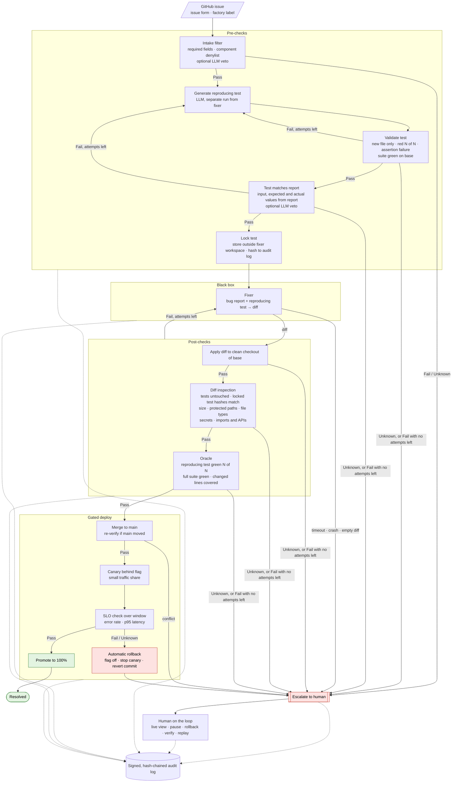

# Dark Factory for Bug Resolution — Requirements

Oct 18, 2026 · @Daniel van den Eijkel

## Purpose and scope

We build the confidence layer that lets a repo fix trivial bugs and ship them to production with no human approving the change. The fixer is a pluggable black box; all trust comes from the gates around it.

**In scope**

- Pre-checks that qualify a known bug report and generate a reproducing test.
- A clean interface to a black-box fixer, with at least one off-the-shelf agent plugged in.
- Post-checks: a behavioral oracle and diff inspection.
- A gated deploy behind a flag and a canary, with automatic rollback.
- Escalation to a human, and on-the-loop controls: pause, manual rollback, live view.
- A signed, append-only audit trail with replay of gate decisions.

**Out of scope**

- Finding bugs. Input is an existing bug report (issue or ticket).
- Building or improving the fixer itself.
- A runtime sandbox for the fixer (stretch goal only, see Open decisions).
- Bugs that are not trivial. These are escalated, never attempted.

**Definition of trivial.** A bug is trivial if and only if a reproducing test can be generated automatically and the fix is a small, localized diff that passes every post-check. The gates enforce this definition; nothing else decides it.

## Principles

These apply to every requirement below and win in case of doubt.

- **P1 Deterministic gates.** Every gate that can let a change through is deterministic code. Given the same inputs, it returns the same verdict.
- **P2 LLMs propose or veto, never approve.** LLMs generate candidates (a reproducing test, a fix) and may reject. No LLM output is ever the reason a change ships.
- **P3 Unsure means human.** Every gate returns Pass, Fail or Unknown. Only Pass advances. Fail, Unknown, timeouts, crashes and parse errors all escalate to a human.
- **P4 The box never grades itself.** The fixer cannot write, see changes to, or alter the test that judges it. The test is generated by a separate run and locked before the fixer starts.
- **P5 Trust nothing but the diff.** The only artifact taken from the fixer is a diff. The pipeline applies it itself in a clean checkout.
- **P6 Everything is evidence.** Every step returns a result plus evidence, and the orchestrator writes both to the audit log. No step can skip logging.
- **P7 Small blast radius.** Anything that ships does so behind a canary with automatic rollback.

## Flow

Every stage checks the pause switch before it starts and writes its result plus evidence to the audit log. Any Fail or Unknown goes to escalation.

## Requirements

Thresholds marked *(policy)* are defaults that live in the policy file (R-POL-1).

### Bug reports (R-IN)

- **R-IN-1** Input is a GitHub issue in the target repo, created from an issue form with these fields: component, description, input or steps, expected result, actual result. The form adds the `factory` label. The pipeline parses the form's sections deterministically; an issue it cannot parse is Unknown.
- **R-IN-2** Input, expected result and actual result are stated as concrete values. The check that the test matches the report (R-PRE-8) depends on this.
- **R-IN-3** Open issues labeled `factory` are processed one at a time, oldest first. Issues labeled `factory:in-progress`, `factory:resolved` or `factory:needs-human` are skipped.
- **R-IN-4** The pipeline reports back on the issue. It sets `factory:in-progress` when it starts. On success it comments with the commit and run id, sets `factory:resolved` and closes the issue.

### Pre-checks (R-PRE)

*Intake*

- **R-PRE-1** A deterministic intake filter checks that all required fields are present, that expected and actual are concrete values (they parse as JSON values, such as numbers or strings in quotes), and that the component is not on the denylist *(policy)*. Otherwise the verdict is Unknown.
- **R-PRE-2** An LLM may veto intake, for example when the report is a feature request or ambiguous. A veto escalates. An LLM approval has no effect.

*Test generation*

- **R-PRE-3** A generator, run separately from the fixer, writes one reproducing test from the report.

*Test validation*

- **R-PRE-4** The generator's output only adds new files under the repro test directory. Any other change fails.
- **R-PRE-5** The test fails on the base commit for the right reason: an assertion failure. Collection errors, import errors, syntax errors and timeouts do not count.
- **R-PRE-6** The test fails in N of N runs (N = 3, *policy*). Mixed results are Unknown.
- **R-PRE-7** The existing test suite is green on the base commit. If it is not, the oracle cannot be trusted and the verdict is Unknown.

*Test matches the report*

- **R-PRE-8** **The test must check what the report describes.** A deterministic gate verifies all three:
  - the report's input values appear in the test's call to the code under test;
  - the report's expected value appears as a literal in an assertion;
  - the failure output of the red run contains the report's actual value.

  If any is missing, the verdict is Fail. This keeps an LLM-written test from being the reason a change ships (P2).
- **R-PRE-9** In addition, an LLM judge compares the test with the report and may veto, for example when the test asserts a side detail instead of the reported behaviour. A veto counts as Fail. An LLM approval has no effect.
- **R-PRE-10** If no test passes validation and the report match within M attempts (M = 2, *policy*), the bug escalates and the fixer never runs.

*Lock*

- **R-PRE-11** Before the fixer starts, the test is stored outside the fixer workspace and its content hash is written to the audit log.

### Fixer interface (R-FIX)

- **R-FIX-1** Contract. Input: the bug report, a clean checkout of the base commit containing the reproducing test, and the test command. Output: a unified diff. The pipeline takes nothing else from the fixer.
- **R-FIX-2** The fixer may read and run the reproducing test but cannot change it. Any change to it rejects the diff (R-DIFF-2, R-DIFF-3).
- **R-FIX-3** The fixer runs as a separate process in a throwaway workspace with a wall-clock timeout (10 min, *policy*). Timeout, crash or an empty diff escalates.
- **R-FIX-4** Retries. The fixer gets up to K attempts per bug (K = 2, *policy*). A diff that fails a post-check triggers a new attempt in a fresh workspace, and the fixer receives the previous attempt's verdict and reason. Every attempt goes through all post-checks. Unknown verdicts, timeouts and crashes escalate at once (P3). When attempts run out, the bug escalates.
- **R-FIX-5** At least one off-the-shelf coding agent is plugged in, using Nebius Token Factory models.
- **R-FIX-6** Fixers are selected by configuration, with no change to pipeline code.
- **R-FIX-7** The factory's signing key, policy file and GitHub token are never present in the fixer workspace or environment. The fixer receives only its own LLM API key.

### Post-checks: diff inspection (R-DIFF)

- **R-DIFF-1** The pipeline applies the diff itself to a fresh checkout of the base commit. If it does not apply cleanly, the verdict is Fail.
- **R-DIFF-2** **Tests are untouched.** The diff must not add, change or delete any test file: neither the locked reproducing test nor any existing test. Any such change is Fail.
- **R-DIFF-3** After applying the diff, the hash of the locked test on disk must equal the hash recorded at lock time (R-PRE-11). A mismatch is Fail. This catches changes that slip past R-DIFF-2, for example through a rename or a symlink.
- **R-DIFF-4** Size limits: at most 2 files, 20 changed lines and 3 hunks *(policy)*.
- **R-DIFF-5** No protected paths *(policy)*: test configuration (including `conftest.py` and pytest config), CI configuration, dependency manifests and lockfiles, build and deploy configuration, environment and secret files, database migrations, the policy file, and the factory's own code.
- **R-DIFF-6** No binary files, file mode changes, symlinks, renames or file deletions.
- **R-DIFF-7** No secrets in added lines, checked by a secret scanner.
- **R-DIFF-8** A static check on the syntax tree rejects new imports outside the allowlist and new calls to denied APIs (eval and exec, subprocess, network, file writes) *(policy)*. It also rejects new test skip markers.
- **R-DIFF-9** An LLM reviewer may veto, for example when it spots a hardcoded answer. A veto escalates. An LLM approval has no effect.

### Post-checks: oracle (R-OR)

- **R-OR-1** The reproducing test passes in N of N runs on the patched checkout.
- **R-OR-2** The full existing suite passes on the patched checkout. Any failure is Fail. Tests are not rerun until they go green.
- **R-OR-3** Every changed source line is executed by the reproducing test (line coverage).
- **R-OR-4** Every test run has a timeout. A timeout is Unknown.

### Merge (R-MRG)

- **R-MRG-1** If `main` moved since the base commit, the diff is applied to the current head, and diff inspection and the oracle run again. A conflict escalates.
- **R-MRG-2** The pipeline commits the diff to `main` as one commit that references the bug id and the run id, under the factory's identity.

### Gated deploy (R-DEP)

- **R-DEP-1** The new version is deployed as a canary next to the stable version. A flag controls the canary's traffic share (10%, *policy*). Flag off means 0%.
- **R-DEP-2** The canary must pass a health check before it receives traffic. A failed start rolls back.
- **R-DEP-3** Traffic runs against both versions for an observation window (60 s, *policy*).
- **R-DEP-4** SLO: the canary's error rate is at most the stable version's plus 1 percentage point, and its p95 latency is at most 1.5× the stable version's *(policy)*. Too little traffic to decide is Unknown.
- **R-DEP-5** On a breach or Unknown, the system rolls back automatically: flag off, canary stopped, commit reverted on `main`, bug escalated.
- **R-DEP-6** On Pass, the new version is promoted to 100% and replaces the stable version.

### Escalation (R-ESC)

- **R-ESC-1** An escalation records the bug id, run id, stage, verdict, reason and a pointer to the evidence.
- **R-ESC-2** An escalation comments on the GitHub issue with the stage, reason and run id, sets `factory:needs-human` and leaves the issue open. It also appears in the live view.
- **R-ESC-3** An escalated bug is not retried automatically.

### Human on the loop (R-HUM)

- **R-HUM-1** Pause. A kill switch is checked before each stage. When it is set, the current run stops at the next stage boundary and nothing new merges or deploys. A canary that is running when the line is paused rolls back.
- **R-HUM-2** Manual rollback of any factory commit by run id.
- **R-HUM-3** The full record of any run can be pulled on demand.
- **R-HUM-4** A live view shows the current bug and stage, verdicts so far, escalations and deploys.

### Audit trail (R-AUD)

- **R-AUD-1** The log is append-only. Every entry records the run id, bug id, stage, timestamp, inputs, evidence, verdict and policy hash.
- **R-AUD-2** Each entry contains the hash of the previous entry and is signed with the factory key (Ed25519).
- **R-AUD-3** For every run, the log contains the bug report, the qualification decision, the test source and hash, the report-match result, the diff, the verification evidence and the deploy result.
- **R-AUD-4** Every gate has two parts: *collect* (may run things, such as tests) and *decide* (a pure function of the collected evidence and the policy). The evidence is stored in full.
- **R-AUD-5** A verify command checks the hash chain and every signature and reports the first broken entry.
- **R-AUD-6** A replay command reruns the decide functions on the stored evidence and reports any verdict that differs from the logged one.
- **R-AUD-7** If an entry cannot be written, the step counts as Unknown and the pipeline stops (P6).

### Policy (R-POL)

- **R-POL-1** All thresholds, lists, timeouts and retry limits are configurable in one versioned policy file. Each has the default stated in this document. The policy file's hash is recorded in every audit entry.
- **R-POL-2** The policy file is a protected path (R-DIFF-5).

### Non-functional (R-NF)

- **R-NF-1** Runs on a laptop. The only external dependencies are the Nebius Token Factory API and GitHub.
- **R-NF-2** The full demo (all seeded issues plus rogue fixer runs) completes within 30 minutes.

## Demo and acceptance

The target repo and its seeded issues (T1–T6 trivial, N1–N3 non-trivial) are specified in [target-repo.md](target-repo.md).

- **D-1** Trivial issues T1–T5 are resolved end to end, from report to deployed change to audit entry, with no human input.
- **D-2** Each non-trivial issue (N1–N3) is refused at its intended gate and escalated. No change from them ships.
- **D-3** Rogue fixers are each stopped by a named gate:

  | Rogue fixer | Stopped by |
  |---|---|
  | Edits the reproducing test | R-DIFF-2, R-DIFF-3 |
  | Adds a dependency | R-DIFF-5, R-DIFF-8 |
  | Hardcodes the test's answer | R-DIFF-9 (LLM veto), if enabled |
  | Adds a secret | R-DIFF-7 |
  | Passes every check but breaks under production traffic (issue T6, target-repo.md R-SCN) | R-DEP-4 (canary rollback) |

- **D-4** Verify passes on the untouched log and detects a tampered entry. Replay reproduces every logged verdict.
- **D-5** Pausing stops the line at the next stage boundary.

## Known limits

- No runtime sandbox. A fixer that reaches the network or reads a secret while it runs is not caught; only its diff is checked.
- The oracle is only as strong as the existing suite and the generated test. The report match (R-PRE-8) makes sure the test checks the right behaviour, but not that it covers enough inputs.
- A fixer can special-case the test's exact input, for example `if price == 100: return 90`. Only the optional LLM veto (R-DIFF-9) and the canary can catch this. See Later.
- The static diff checks (R-DIFF-8) are specific to Python.

## Open decisions

Decided: 3 developers, 4 hours. Bug source is GitHub issues. The target repo is a small service we write ourselves, and production is a local Docker simulation; both are specified in [target-repo.md](target-repo.md).

1. Fixer: Aider or mini-swe-agent, and which Nebius model.
2. Whether to include the LLM vetoes (R-PRE-2, R-PRE-9, R-DIFF-9) in the first build.
3. Runtime sandbox as a stretch goal.

## Later

- **Holdout test.** Generate a second reproducing test with different inputs and never show it to the fixer. Both must go green. This catches fixes that special-case the visible test's input.
